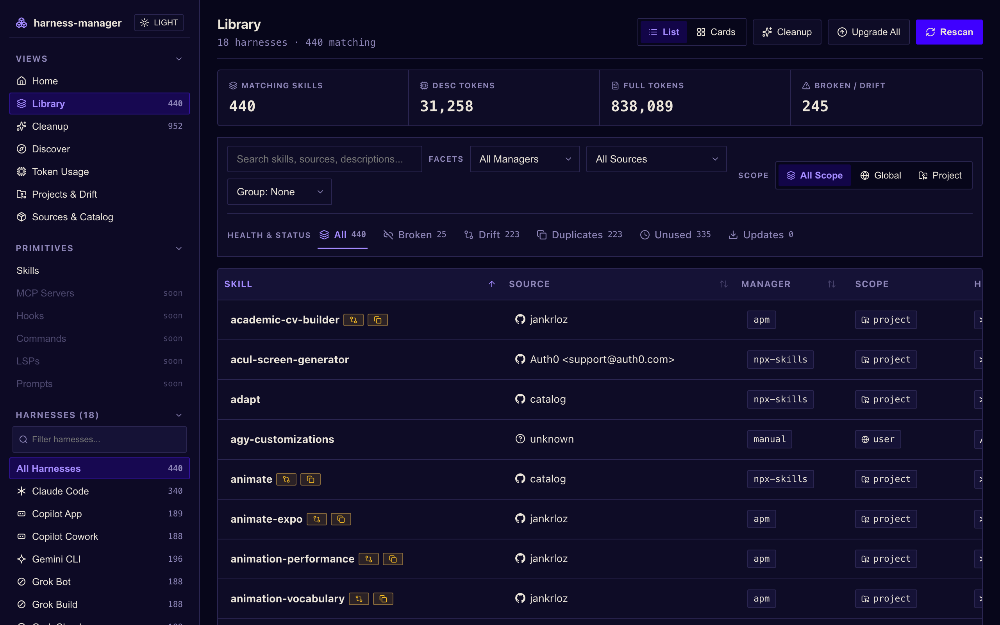
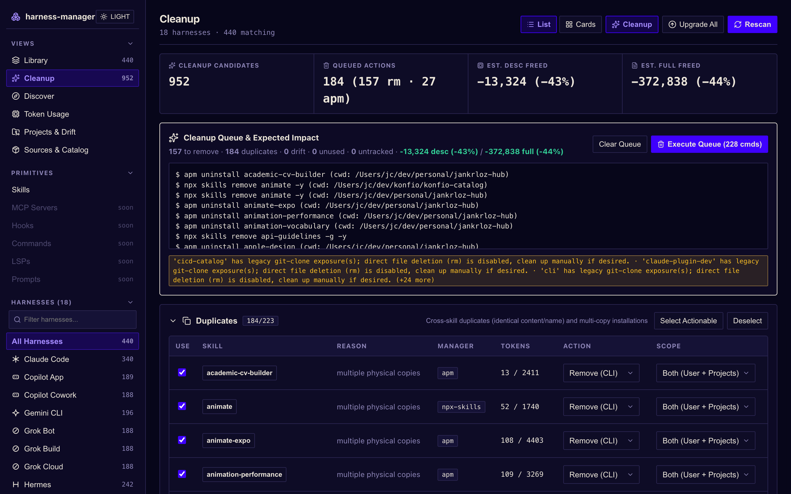
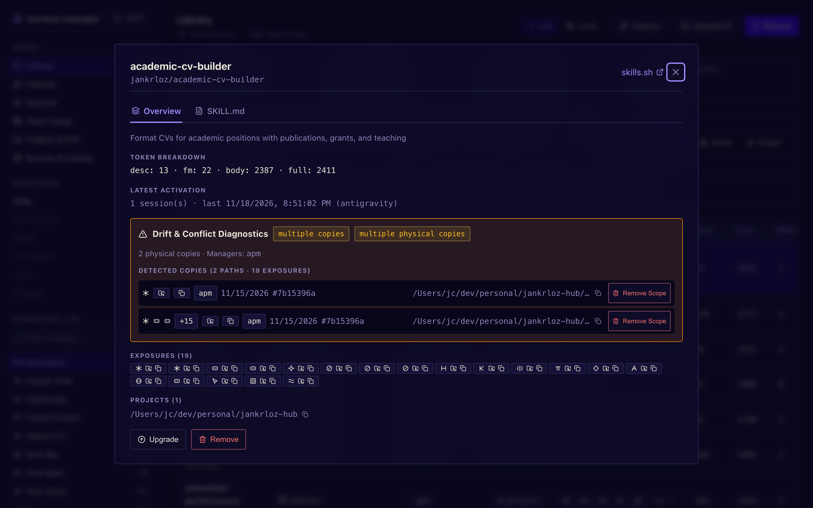

<p align="center">
  
</p>

<h1 align="center">harness-control</h1>

<p align="center">
  Unified control plane for AI coding harness skills — inventory, token telemetry, drift &amp; duplicate diagnostics, and manager-delegated lifecycle actions across Web, Desktop (macOS / Linux / Windows), TUI, and CLI.
</p>

<p align="center">
  <a href="https://github.com/jankrloz/harness-control/actions/workflows/ci.yml"></a>
  <a href="https://github.com/jankrloz/harness-control/releases"></a>
  <a href="https://semver.org/"></a>
  
  <a href="LICENSE"></a>
</p>

<p align="center">
  <a href="https://jankrloz.github.io/harness-control/">Homepage</a> ·
  <a href="#features">Features</a> ·
  <a href="#screenshots">Screenshots</a> ·
  <a href="#quick-start">Installation</a> ·
  <a href="docs/CLI.md">CLI &amp; TUI Docs</a> ·
  <a href="docs/ROADMAP.md">Roadmap</a> ·
  <a href="docs/BRANDING.md">Branding</a> ·
  <a href="#contributing">Contributing</a>
</p>

---

## Why harness-control?

AI coding assistants (`Claude Code`, `Codex`, `Gemini CLI`, `OpenCode`, `Cursor`, `Windsurf`, `Antigravity`, `Kiro`, `Hermes`, `OpenClaw`, `Pi`, `Copilot`, etc.) each store `SKILL.md` files across global user directories, profile directories (`~/.claude`, `~/.claude-*`), and workspace `.agents/skills` folders. Over time this creates:

- **Silent context bloat** from unused or duplicated skills injected into system prompts
- **Global vs. project drift** where workspace copies diverge, age behind, or use a different package manager
- **Duplicate copies** across harnesses or sources with identical content

`harness-control` scans every harness and workspace, measures exact `tiktoken` (`cl100k_base`) description/frontmatter/body token budgets, tracks real activations from `.jsonl` session transcripts (never polluting `atime`), and delegates every `install`, `upgrade`, `remove`, and `migrate-to-apm` action strictly to the owning package manager CLI (`apm`, `npx skills`, `claude plugin`, `gemini extensions`) — **never direct `rm` or `git pull`**.

---

## Screenshots

### Home Overview & Metrics


### Skills Library (Scope, Manager, Source & Health Filters)



### Cleanup Planner & Expected Token Impact



### Drift & Conflict Diagnostics Modal



---

## Features

- **Home Control Center**: Overall metrics (`Total Skills`, `Token Footprint`, `Drift / Duplicates`, `Cleanup Candidates`), quick actions, view cards, heaviest skills, and heaviest projects.
- **18-Harness & Multi-Profile Discovery**: Scans `Claude Code` (`~/.claude` + `~/.claude-*` profiles), `Codex`, `Gemini CLI`, `Antigravity`, `OpenCode`, `Cursor`, `Windsurf`, `Kiro`, `Hermes`, `OpenClaw`, `Pi`, `Copilot`, `Grok`, and `DeepSeek`.
- **Global & Project Token Usage**: `tiktoken` measurement split by `description`, `frontmatter`, `body`, and `full` tokens across global/user scope, workspaces, harnesses, and sources.
- **Session-Log Activation Tracking**: Reads `.jsonl` transcripts (`~/.claude*/projects`, `~/.codex/sessions`, `~/.gemini/antigravity/brain`) to surface unused skills and latest activations.
- **Drift & Duplicate Resolution**: Detects `global-project-overlap`, `content-divergence`, `multiple-copies`, `multiple-managers`, `duplicate-source`, and relative age (`newer` / `older` / `same` vs. global) with one-click **Remove Project Copies** or **Remove Sibling**.
- **Full-Page Cleanup Planner (Web, TUI `[7] Cleanup`, CLI `cleanup`)**: Categorizes `duplicates`, `drift`, `unused`, `untracked`, `broken`, and `outdated` skills with live `-tokens (-%)` impact preview and manager-CLI execution queue.
- **Discover & Install**: Search `skills.sh` trending/search catalogs (with `npx skills find` fallback) and install globally or per-project via `npx skills` or `APM`.
- **Manager-Only Safety**: All removals and upgrades run through `apm`, `npx skills`, `claude plugin`, or `gemini extensions` with mandatory dry-run command previews and scope selection (`Both`, `User / Global only`, `All Projects`, or `Select by project`).

---

## Quick Start

### Prerequisites

- Node.js `>= 22`
- `pnpm >= 10`
- [go-task](https://taskfile.dev) (optional, recommended)
- Rust toolchain (only if building the Tauri v2 desktop app locally)

### Install & Run

```bash
git clone https://github.com/jankrloz/harness-control.git
cd harness-control
pnpm install
task build
```

Run the Core Daemon + Web Dashboard:

```bash
task daemon:start
pnpm --filter @harness-control/web dev
```

Run the interactive 7-module TermUI TUI:

```bash
node packages/cli/dist/bin.js
```

Run CLI commands directly:

```bash
node packages/cli/dist/bin.js cleanup --only duplicates
node packages/cli/dist/bin.js tokens
node packages/cli/dist/bin.js list --drift
```

See [docs/CLI.md](docs/CLI.md) for the complete CLI & TUI reference.

---

## Cross-Platform Distribution (macOS, Linux, Windows)

GitHub Actions workflows are pre-configured in [`.github/workflows/ci.yml`](.github/workflows/ci.yml) and [`.github/workflows/release.yml`](.github/workflows/release.yml):

- **macOS**: `.app` & `.dmg` (`universal-apple-darwin`)
- **Linux**: `.AppImage` & `.deb` (`ubuntu-22.04`)
- **Windows**: `.msi` & `.exe` (`windows-latest`)

Tagging a release (`git tag v0.1.0 && git push origin v0.1.0`) builds and attaches installers for all three platforms.

---

## Architecture

```text
packages/core     Hexagonal domain, application services (Inventory, Action, Cleanup, Telemetry),
                  and adapters (FsScanner, NativeCliAdapter, GitInspector, Tiktoken, UsageLogInspector)
packages/server   Local Hono HTTP daemon on 127.0.0.1:4318
packages/cli      Commander CLI + TermUI (@termuijs/jsx) interactive 7-module TUI
apps/web          React 19 + Vite dashboard (kanon-ui design tokens)
apps/desktop      Tauri v2 native desktop shell (macOS, Linux, Windows)
```

---

## Contributing

Contributions are welcome. Read [AGENTS.md](AGENTS.md) for architecture boundaries and non-negotiable rules (especially manager-only `remove` / `upgrade` and `.jsonl`-based activation tracking).

```bash
pnpm install
task build
task check
task test
```

Open a pull request against `main` with passing CI checks.

---

## License

[MIT](LICENSE)
