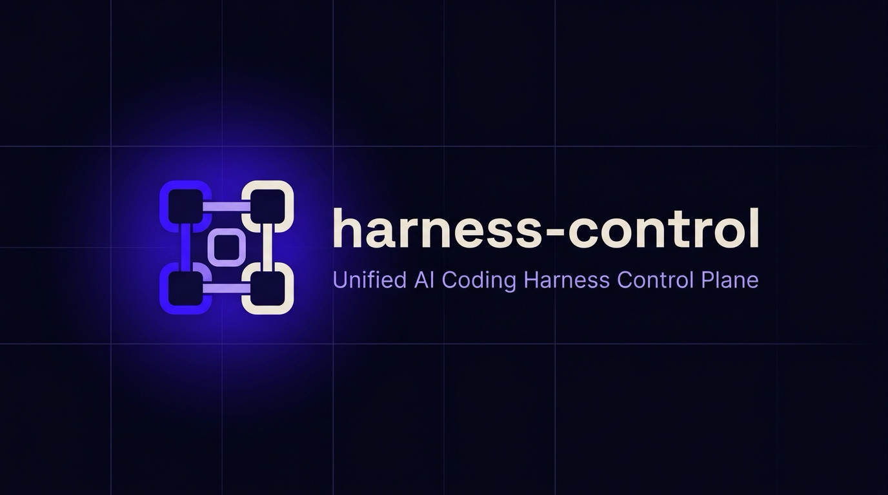
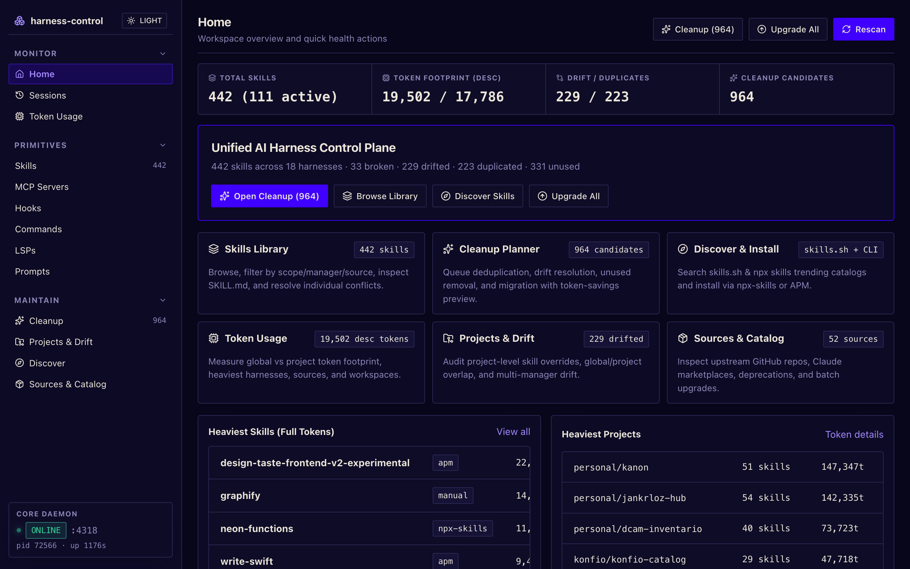
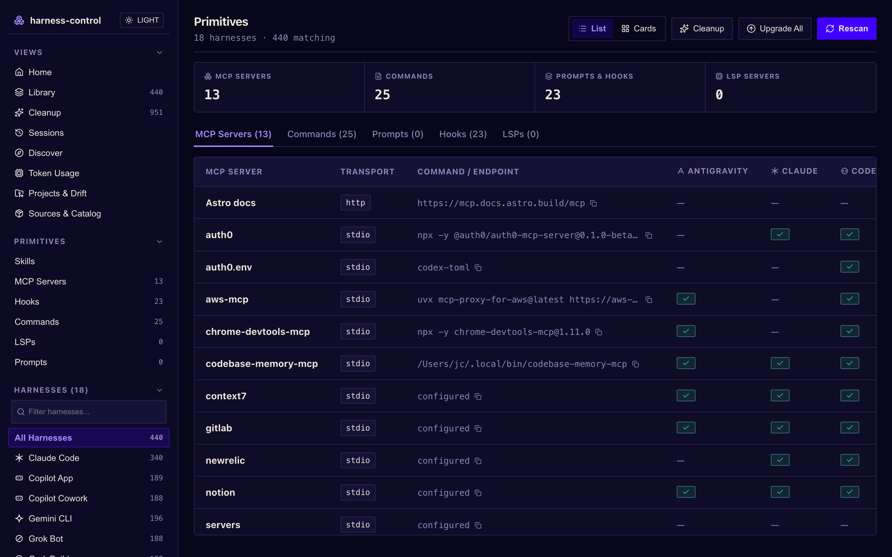
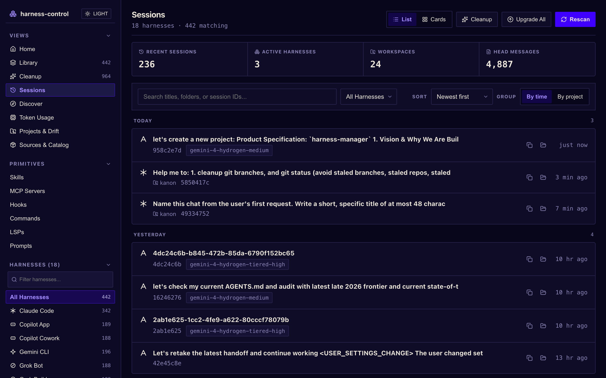
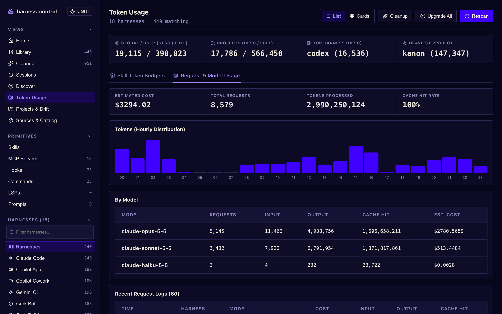

<p align="center">
  
</p>

<h1 align="center">harness-control</h1>

<p align="center">
  Unified control plane for AI coding harness skills, primitives, sessions, and token usage across Desktop (macOS / Linux / Windows), Web, TUI, and CLI.
</p>

<p align="center">
  <a href="https://github.com/jankrloz/harness-control/actions/workflows/ci.yml"></a>
  <a href="https://github.com/jankrloz/harness-control/releases"></a>
  <a href="https://semver.org/"></a>
  
  
  <a href="LICENSE"></a>
</p>

<p align="center">
  <a href="https://jankrloz.github.io/harness-control/">Homepage</a> ·
  <a href="#privacy">100% Local &amp; Private</a> ·
  <a href="#features">Features</a> ·
  <a href="#screenshots">Screenshots</a> ·
  <a href="#installation">Installation</a> ·
  <a href="docs/CLI.md">CLI &amp; TUI Docs</a> ·
  <a href="docs/ROADMAP.md">Roadmap</a>
</p>

---

## Privacy

**Everything runs 100% locally on your machine. Nothing is ever sent to a remote server.**

- **Zero telemetry or analytics:** No tracking, no cloud accounts, no background uploads.
- **Local-only scanning:** Skill directories, `tiktoken` counts, MCP/hook configs, and `.jsonl` session transcripts are read exclusively on your machine through a local daemon bound to `127.0.0.1:4318`.
- **Your workspace stays private:** Project paths, session titles, prompts, and cost estimates never leave your computer.
- **Explicit network actions only:** Outbound requests only happen when _you_ explicitly search `skills.sh` in **Discover** or run an update check/install via your local package manager (`apm`, `npx skills`).

---

## Why harness-control?

AI coding assistants (`Claude Code`, `Codex`, `Gemini CLI`, `OpenCode`, `Cursor`, `Windsurf`, `Antigravity`, `Kiro`, `Hermes`, `OpenClaw`, `Pi`, `Copilot`, etc.) each store `SKILL.md` files across global user directories, `~/.claude-*` profiles, and workspace `.agents/skills` folders. Over time this creates:

- **Silent context bloat** from unused or duplicated skills injected into system prompts
- **Global vs. project drift** where workspace copies diverge, age behind, or use a different package manager
- **Duplicate copies** across harnesses or sources with identical content

`harness-control` gives you a single control plane to inspect, measure, clean up, and keep skills up to date — delegating every `install`, `upgrade`, `remove`, and `migrate-to-apm` action strictly to the owning package manager CLI (`apm`, `npx skills`, `claude plugin`, `gemini extensions`), **never direct `rm` or `git pull`**.

---

## Screenshots

### Home Overview & Metrics



### Skills Library (Scope, Manager, Source & Health Filters)


### Cleanup Planner & Expected Token Impact


### Primitives & MCP Cross-Harness Matrix



### Unified Sessions Explorer



### Request & Model Usage Dashboard



---

## Features

- **Home Control Center**: Overall metrics (`Total Skills`, `Token Footprint`, `Drift / Duplicates`, `Cleanup Candidates`), quick actions, view cards, heaviest skills, and heaviest projects.
- **18-Harness & Multi-Profile Discovery**: Scans `Claude Code` (`~/.claude` + `~/.claude-*` profiles), `Codex`, `Gemini CLI`, `Antigravity`, `OpenCode`, `Cursor`, `Windsurf`, `Kiro`, `Hermes`, `OpenClaw`, `Pi`, `Copilot`, `Grok`, and `DeepSeek`.
- **Primitives Matrix**: Unified visibility for `MCP Servers` (cross-harness matrix), `Commands`, `Prompts`, `Hooks`, and `LSPs`.
- **Unified Sessions Explorer**: Browse recent sessions across `Claude Code`, `Codex`, and `Antigravity`, grouped `By time` or `By project`, with search by title, folder, or session ID.
- **Token Budgets & Request Usage**: `tiktoken` skill budgets (`description`, `frontmatter`, `body`, `full`) plus session `.jsonl` request logs, estimated cost, cache hit rate, hourly chart, and per-model breakdown.
- **Drift & Duplicate Resolution**: Detects `global-project-overlap`, `content-divergence`, `multiple-copies`, `multiple-managers`, `duplicate-source`, and relative age (`newer` / `older` / `same` vs. global) with one-click **Remove Project Copies** or **Remove Sibling**.
- **Full-Page Cleanup Planner (Web, TUI `[7] Cleanup`, CLI `cleanup`)**: Categorizes `duplicates`, `drift`, `unused`, `untracked`, `broken`, and `outdated` skills with live `-tokens (-%)` impact preview and manager-CLI execution queue.
- **Discover & Install**: Search `skills.sh` trending/search catalogs (with `npx skills find` fallback) and install globally or per-project via `npx skills` or `APM`.
- **Manager-Only Safety**: All removals and upgrades run through `apm`, `npx skills`, `claude plugin`, or `gemini extensions` with mandatory dry-run command previews and scope selection (`Both`, `User / Global only`, `All Projects`, or `Select by project`).

---

## Installation

### 1. Homebrew (macOS)

Desktop app:

```bash
brew install --cask jankrloz/tap/harness-control
```

CLI & TUI:

```bash
brew install jankrloz/tap/harness-control
```

### 2. Desktop Installers (macOS, Linux, Windows)

Download native installers from [GitHub Releases](https://github.com/jankrloz/harness-control/releases):

- **macOS**: `.dmg` / `.app` (Universal Apple Silicon + Intel)
- **Linux**: `.AppImage` / `.deb`
- **Windows**: `.msi` / `.exe`

### 3. npm / npx / pnpm (CLI & TUI)

Run immediately with `npx` or install globally:

```bash
npx @harness-control/cli
```

```bash
pnpm add -g @harness-control/cli
```

### 4. Manual Clone (From Source)

Requires Node.js `>= 22` and `pnpm >= 10`:

```bash
git clone https://github.com/jankrloz/harness-control.git
cd harness-control
pnpm install
pnpm build
node packages/cli/dist/bin.js
```

---

## Usage

Launch the interactive 7-module TUI:

```bash
harness-control
```

Run CLI commands directly:

```bash
harness-control cleanup --only duplicates
harness-control tokens
harness-control list --drift
```

See [docs/CLI.md](docs/CLI.md) for the complete CLI & TUI reference and [docs/ROADMAP.md](docs/ROADMAP.md) for upcoming releases (profiles/accounts, provider routing, and native menu bar widgets).

---

## License

[MIT](LICENSE)
